# Setting Up Authentication

ArchiveBox supports several types of authentication for users logging in via the Admin Web UI or REST API.

## Set Up Admin Web UI Permissions

Use these options to set up your desired permissions for non-admin guest users:
- [`PUBLIC_INDEX=True`](https://github.com/ArchiveBox/ArchiveBox/wiki/Configuration#public_index): Default *allows* non-logged-in users to see Snapshot list
- [`PUBLIC_ADD_VIEW=False`](https://github.com/ArchiveBox/ArchiveBox/wiki/Configuration#public_add_view): Default *doesn't allow* non-logged-in users to submit new URLs
- [`PERMISSIONS=public`](https://github.com/ArchiveBox/ArchiveBox/wiki/Configuration#permissions): Default *allows* non-logged-in users to see Snapshot content (set to `unlisted` or `private` to gate it; replaces the removed legacy `PUBLIC_SNAPSHOTS` toggle, which was a global on/off — `PERMISSIONS` is now per-Snapshot)

> [!NOTE]
> ArchiveBox does not currently support setting up *non-admin* users and groups with custom permissions.

- [Wiki: Configuration](https://github.com/ArchiveBox/ArchiveBox/wiki/Configuration#permissions) (`PUBLIC_INDEX`, `PUBLIC_ADD_VIEW`, `PERMISSIONS`)
- [Wiki: Security Overview](https://github.com/ArchiveBox/ArchiveBox/wiki/Security-Overview)

<br/>
<br/>

## Admin Web UI Authentication Methods


<br/>

### Username & Password (the default)

On a new server, open <http://admin.archivebox.localhost:5797/admin/> to create the first admin through the setup UI. Existing users can be created or edited from the CLI:

```bash
archivebox manage createsuperuser
archivebox manage changepassword <username>

# equivalent: docker compose run --rm archivebox manage [...]
# equivalent: docker run -v $PWD:/data archivebox/archivebox:dev manage [...]
```

Existing users can be managed from the Admin UI here: [`/admin/auth/user/`](http://admin.archivebox.localhost:5797/admin/auth/user/),
and you can change your password here: [`/admin/password_change/`](http://admin.archivebox.localhost:5797/admin/password_change/).

<br/>
<br/>

### Reverse Proxy Authentication

> Can be used with a reverse proxy auth provider like [oauth2-proxy](https://github.com/oauth2-proxy/oauth2-proxy), [Cloudflare Zero Trust](https://developers.cloudflare.com/cloudflare-one/tutorials/access-workers/#create-a-worker-with-custom-headers), [Authentik](https://docs.goauthentik.io/docs/providers/proxy/), and others.

Set these ArchiveBox configuration values based on your reverse proxy setup and needs:
```bash
# REQUIRED: the header where your upstream reverse proxy will place the authenticated user's username/email
# EXAMPLE: Cf-Access-Authenticated-User-Email (if using Cloudflare Access / Zero Trust)
REVERSE_PROXY_USER_HEADER=X-Remote-User

# REQUIRED: the IP/CIDR of your upstream reverse proxy server
# WARNING: make sure this range contains ONLY your reverse proxy server!
# ArchiveBox will completely trust any IP in this range for authentication
REVERSE_PROXY_WHITELIST=192.0.2.3/32

# OPTIONAL: redirect users to an external URL after they log out
LOGOUT_REDIRECT_URL=https://auth.yourcompany.example.com/after/logout
```

- https://github.com/ArchiveBox/ArchiveBox/wiki/Configuration#reverse_proxy_user_header
- https://github.com/ArchiveBox/ArchiveBox/wiki/Configuration#reverse_proxy_whitelist
- https://github.com/ArchiveBox/ArchiveBox/wiki/Configuration#logout_redirect_url
- https://github.com/ArchiveBox/ArchiveBox/pull/866

<br/>

### LDAP Authentication

> Can be used with an SSO provider like [Authentik](https://github.com/goauthentik/authentik), [Authelia](https://github.com/authelia/authelia), [Okta / Auth0](https://www.okta.com/), [Keycloak](https://www.keycloak.org/), and others.

First, install the `ldap` add-on to use this feature (not needed for Docker Archivebox).
```bash
uv tool install --python 3.13 --prerelease explicit --upgrade 'archivebox[ldap]>=0.9.0rc0,<0.10'
```

Then set these configuration values to finish configuring LDAP:
```bash
LDAP_ENABLED=True
LDAP_SERVER_URI="ldap://ldap.example.com:3389"
LDAP_BIND_DN="ou=archivebox,ou=services,dc=ldap.example.com"
LDAP_BIND_PASSWORD="secret-bind-user-password"
LDAP_USER_BASE="ou=users,ou=archivebox,ou=services,dc=ldap.example.com"
LDAP_USER_FILTER="(objectClass=user)"

LDAP_USERNAME_ATTR="uid"
LDAP_FIRSTNAME_ATTR="givenName"
LDAP_LASTNAME_ATTR="sn"
LDAP_EMAIL_ATTR="mail"
```

- https://github.com/ArchiveBox/ArchiveBox/wiki/Configuration#ldap
- https://github.com/ArchiveBox/ArchiveBox/pull/1214
- https://github.com/django-auth-ldap/django-auth-ldap#example-configuration
- https://jumpcloud.com/blog/what-is-ldap-authentication

<br/>

<a id="not-yet-supported-saml--oauth2--openid-authentication"></a>

### SAML / OAuth2 / OpenID Authentication

Single sign-on (SSO) lets users sign in to ArchiveBox with an account managed by Keycloak, Authentik, Okta, or another identity provider. Choose OpenID Connect (OIDC) for a new setup, or SAML if your organization requires it. You can keep local password login enabled alongside SSO.

#### Install and enable native SSO

Install the development branch with the SAML extra (which also includes OIDC/OAuth):

```bash
uv tool install --python 3.13 'archivebox[saml] @ git+https://github.com/ArchiveBox/ArchiveBox.git@dev'
```

The `allauth` extra adds OIDC/OAuth support; `saml` adds both OIDC/OAuth and SAML. Development Docker images include both. If SAML installation needs to build xmlsec, install your operating system's xmlsec and libxml2 development packages first.

Create a collection with `archivebox init --quick` if needed, start the server, and open `/admin/login/` to create the first local administrator. Keep this local login available while configuring the provider.

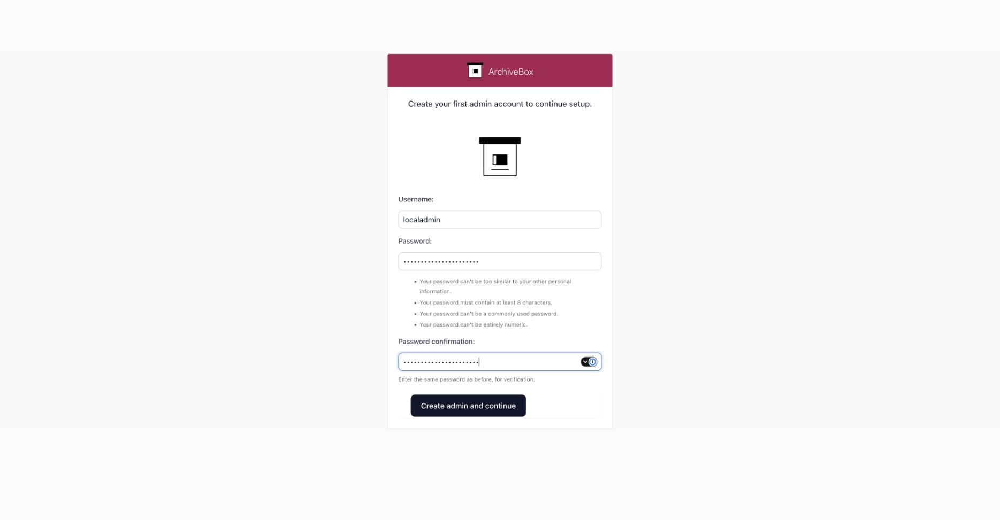

Set `BASE_URL` to your ArchiveBox address and choose `SERVER_SECURITY_MODE` before configuring your identity provider. With `safe-subdomains-fullreplay`, login uses the `admin.` subdomain. Use your server's HTTPS address wherever the instructions below show `http://admin.archivebox.localhost:5797`.

In the collection's `ArchiveBox.conf`, enable SSO and choose your enrollment policy:

```ini
[ALLAUTH_CONFIG]
ALLAUTH_ENABLED = True
REGISTRATION_ENABLED = True
REGISTRATION_MODE = approval
EMAIL_VERIFICATION = none
```

ArchiveBox accounts are administrators. These settings allow new SSO accounts but require an existing administrator to approve them before they can sign in. To allow only existing accounts, set `REGISTRATION_ENABLED=False` and connect each administrator's SSO identity from **Account → Connections**. Local accounts are created by an administrator; there is no public signup form.

Back up an existing database before upgrading. With the same configuration/environment as the server, run `archivebox manage migrate --noinput` inside the collection, then restart the server. In Docker Compose, run `docker compose exec archivebox archivebox manage migrate --noinput`, then `docker compose restart archivebox`.

Set `ALLAUTH_ENABLED=True` to enable SSO. Existing usernames and passwords continue to work. Users need to sign in again after you enable or disable allauth; linked identities are preserved.

#### Create an identity-provider realm and user

Open your Keycloak administration console. If you need to install Keycloak first, follow its [getting-started guide](https://www.keycloak.org/getting-started/getting-started-zip). A realm is a separate set of users and applications; create one for ArchiveBox or use an existing realm.

1. Sign in to Keycloak's administration console. Choose **Manage realms → Create realm**, name it `archivebox-demo`, and leave it enabled.
2. In that realm, choose **Users → Create new user**. Enter a username, email, first name, and last name. Use `sso-demo` and `sso-demo@example.com`, or enter your own user details.
3. Open the user's **Credentials → Set password**. Set an initial password. Leave **Temporary** on to require the user to change it at first sign-in, or turn it off to keep that password.

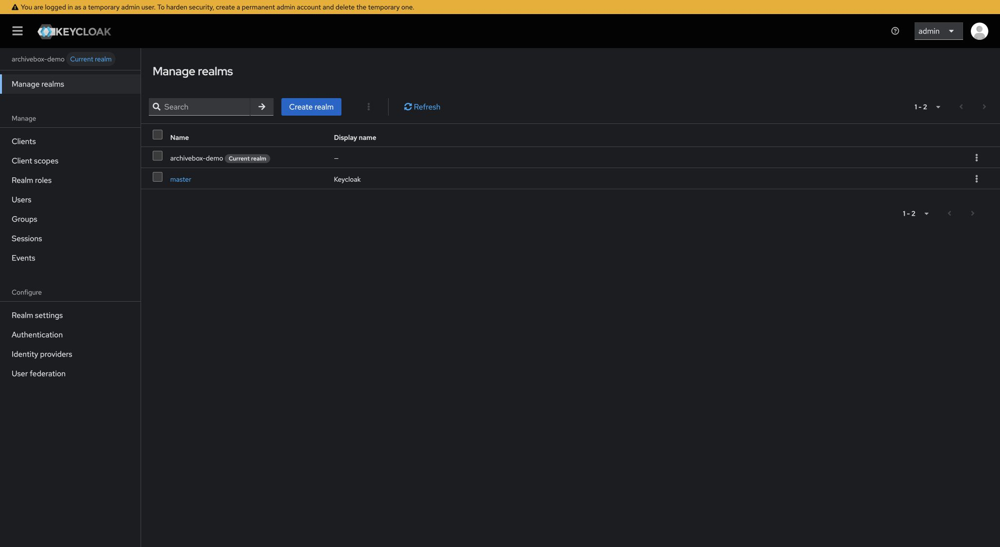

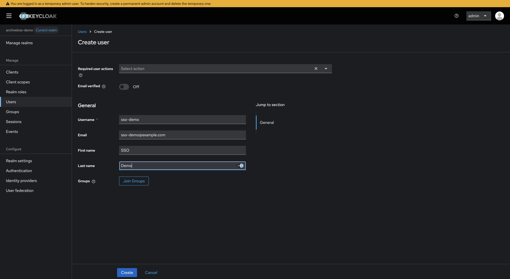

#### OIDC setup with Keycloak

In **Clients → Create client**, select **OpenID Connect**, use client ID `archivebox`, and name it `ArchiveBox OIDC`.

On **Capability config**, turn **Client authentication** on, leave **Standard flow** on, and choose **PKCE Method: S256**. Leave implicit flow, direct access grants, service accounts, and other unused grants off.

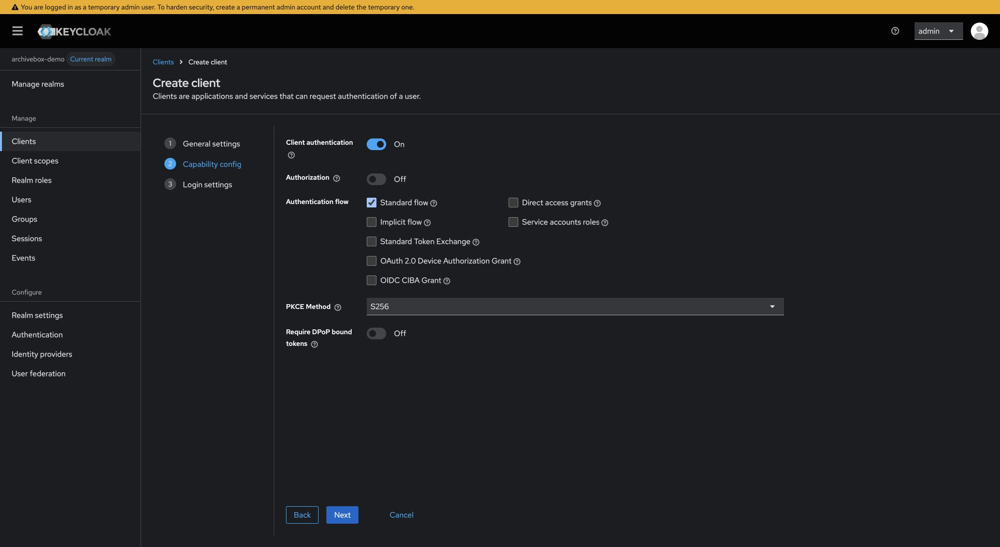

On **Login settings**, enter:

| Field | Value |
| --- | --- |
| Root URL | `http://admin.archivebox.localhost:5797` |
| Home URL | `http://admin.archivebox.localhost:5797/admin/` |
| Valid redirect URIs | `http://admin.archivebox.localhost:5797/accounts/oidc/keycloak/login/callback/` |

Register the exact callback, including its trailing slash. Save the client, then open **Credentials** and copy the **Client Secret**.

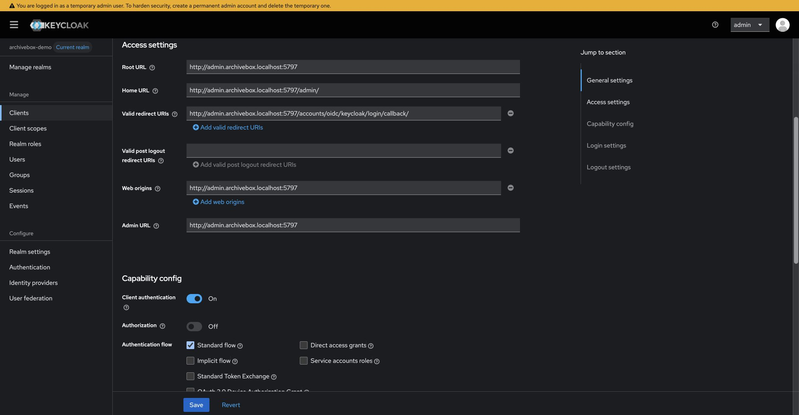

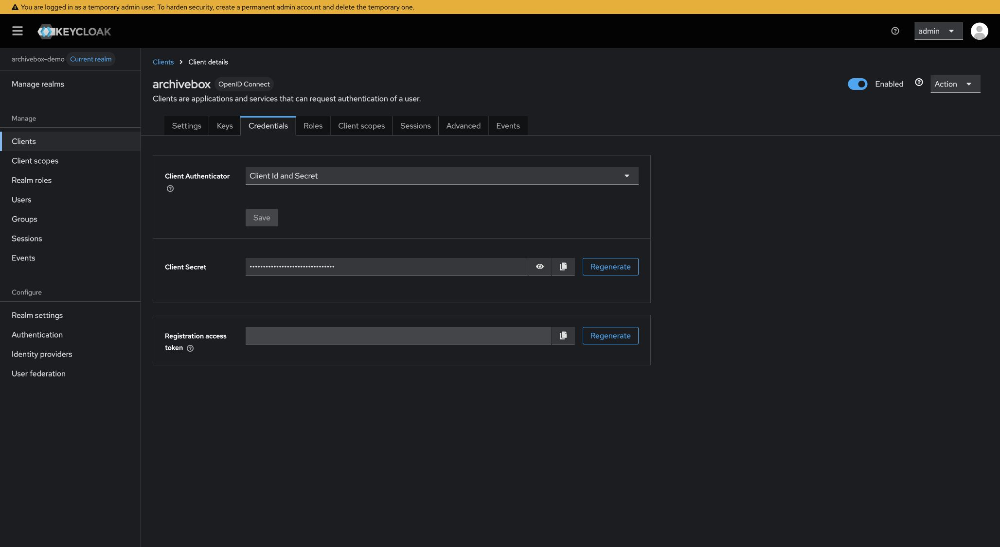

Set `SOCIALACCOUNT_PROVIDERS` to the following JSON in your server environment or as a single-line value under `[ALLAUTH_CONFIG]` in `ArchiveBox.conf`. Replace `YOUR_CLIENT_SECRET` with the copied value and restart ArchiveBox.

```json
{
  "openid_connect": {
    "OAUTH_PKCE_ENABLED": true,
    "APPS": [{
      "provider_id": "keycloak",
      "name": "Keycloak OIDC",
      "client_id": "archivebox",
      "secret": "YOUR_CLIENT_SECRET",
      "settings": {
        "server_url": "http://127.0.0.1:8080/realms/archivebox-demo"
      }
    }]
  }
}
```

The issuer must be reachable by both the browser and the ArchiveBox server. In containers, `127.0.0.1` refers to each container itself; use a shared, resolvable HTTPS IdP hostname instead. Multiple OIDC providers use separate `APPS` with unique, stable `provider_id` values. Authentik, Authelia, Okta and other providers have their own client-registration screens; use their discovery issuer and the matching ArchiveBox callback.

Provider settings are server credentials: restart after editing, keep the config private, and do not put them in capture/persona settings. ArchiveBox redacts them in config displays/exports and excludes them from capture-hook environments.

#### Sign in with OIDC and approve the new account

1. Log out of ArchiveBox and open `/admin/login/`. After initial administrator setup, this redirects directly to the allauth login page with local-password and provider choices.
2. Choose **Keycloak OIDC**, then **Continue**.
3. Sign in at Keycloak with the user you created. On the first return, ArchiveBox displays **Account Inactive** because approval is enabled.
4. Sign in locally as the original administrator. In **Admin Users**, open `sso-demo`, check **Active**, and **Save**. Review staff/superuser permissions before approving.
5. Log out locally and repeat the OIDC login. ArchiveBox now displays **Successfully signed in as sso-demo** on the admin page.

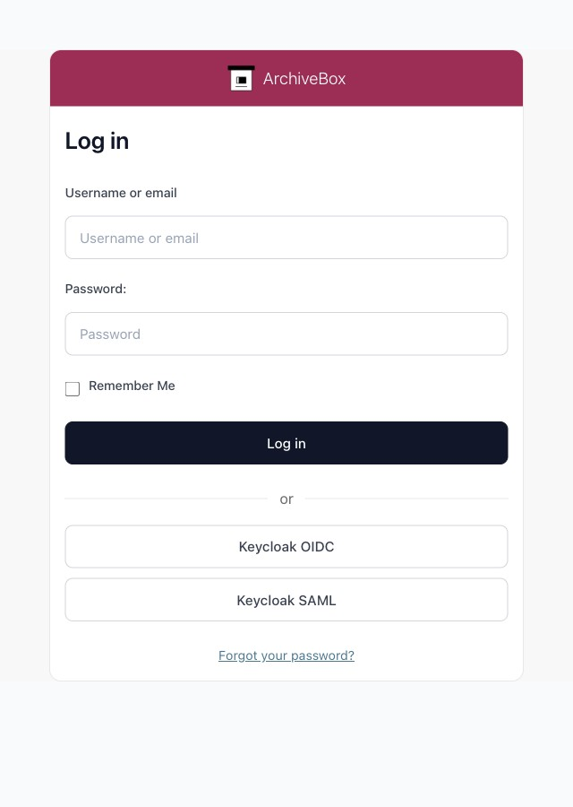

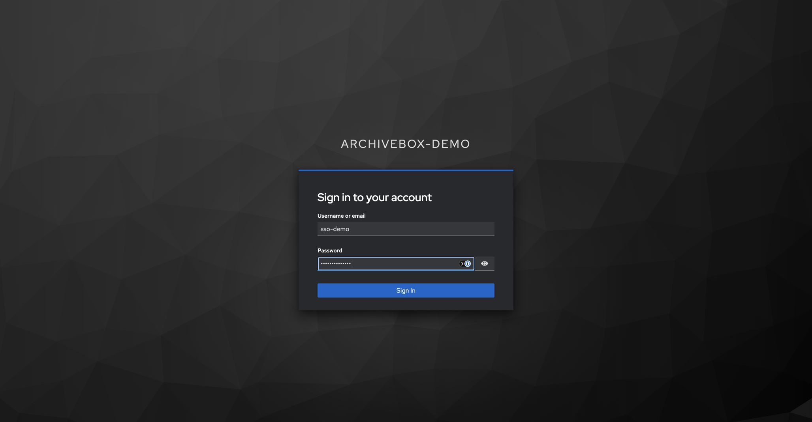

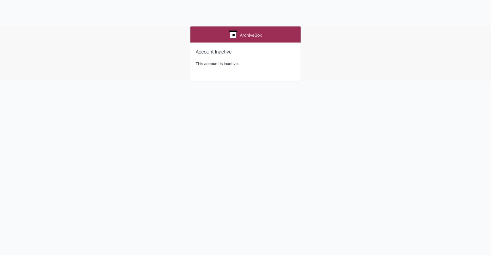

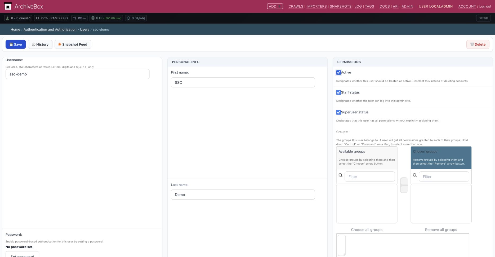

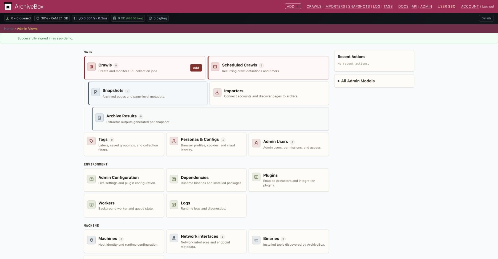

#### SAML setup with Keycloak

You can use SAML on its own or alongside OIDC. To use both with one ArchiveBox account, sign in to that account and connect SAML as described below.

Create another Keycloak client with **Client type: SAML**, name `ArchiveBox SAML`, and the following values:

| Purpose | Value |
| --- | --- |
| Client ID / SP entity ID / metadata | `http://admin.archivebox.localhost:5797/accounts/saml/keycloak/metadata/` |
| Valid redirect URIs | `http://admin.archivebox.localhost:5797/accounts/saml/keycloak/acs/` |
| Master SAML Processing URL (HTTP POST ACS) | `http://admin.archivebox.localhost:5797/accounts/saml/keycloak/acs/` |
| SLS callback, when configuring IdP logout | `http://admin.archivebox.localhost:5797/accounts/saml/keycloak/sls/` |

Leave **IDP-Initiated SSO URL name** and its relay state empty: this configuration requires SP-initiated login. The metadata endpoint can also supply your IdP's import workflow.

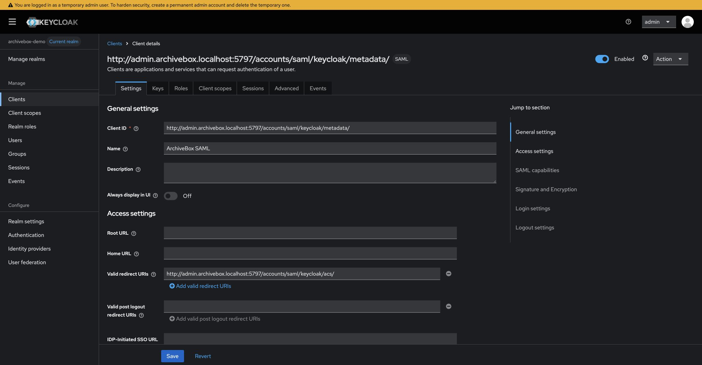

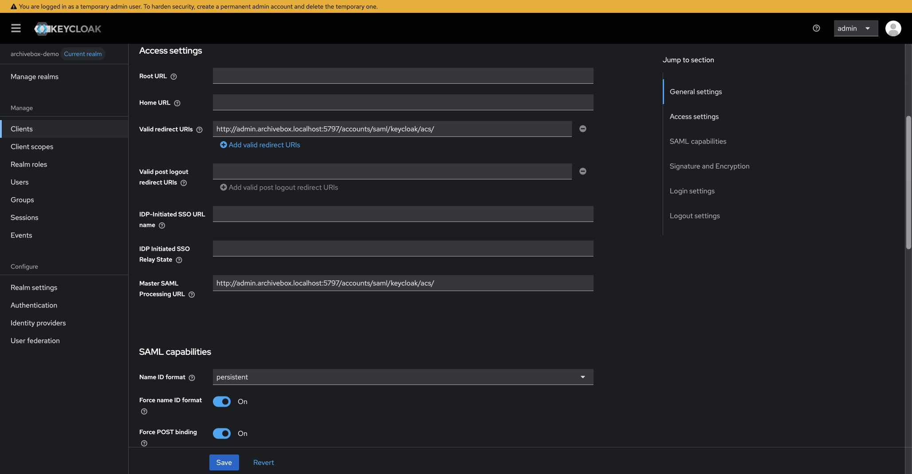

In the saved client's **Settings**:

- Set **Name ID format: persistent** and **Force name ID format: On**.
- Keep **Force POST binding** and **Include AuthnStatement** on.
- Keep **Sign documents** on and enable **Sign assertions**.
- Use **RSA_SHA256** and **EXCLUSIVE** canonicalization.

In **Keys**, turn **Client signature required** off. Keep IdP assertion signing enabled. To also sign ArchiveBox's requests or encrypt assertions, configure a certificate and private key using [allauth's SAML settings](https://docs.allauth.org/en/latest/socialaccount/providers/saml.html), import the matching SP metadata into Keycloak, and enable the corresponding controls.

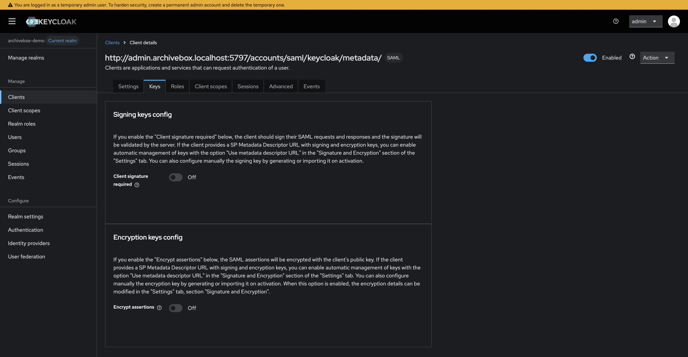

Open **Client scopes → the dedicated scope → Mappers → Configure a new mapper** (or **Add mapper → By configuration** after the first). Choose **User Property** and create these four mappings, with **SAML Attribute NameFormat: Basic**:

| Name | Property | SAML Attribute Name |
| --- | --- | --- |
| `email` | `email` | `email` |
| `username` | `username` | `username` |
| `firstName` | `firstName` | `firstName` |
| `lastName` | `lastName` | `lastName` |

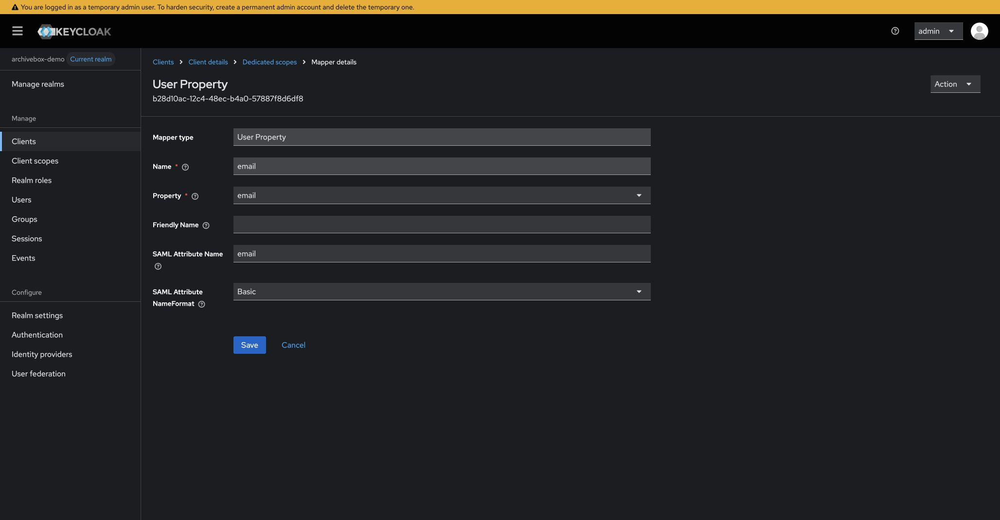

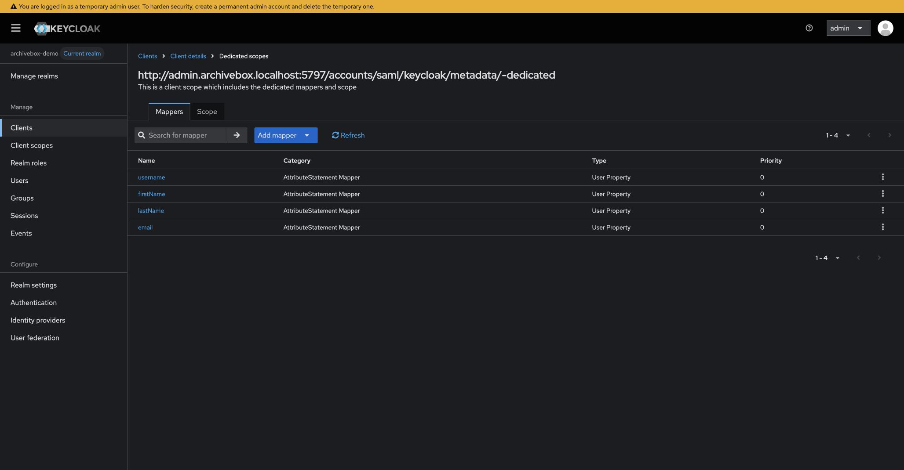

Add the `saml` entry below to the **same** `SOCIALACCOUNT_PROVIDERS` dictionary, keeping `openid_connect` if you want both buttons, then restart ArchiveBox:

```json
{
  "saml": {
    "APPS": [{
      "provider_id": "http://127.0.0.1:8080/realms/archivebox-demo",
      "name": "Keycloak SAML",
      "client_id": "keycloak",
      "settings": {
        "idp": {
          "entity_id": "http://127.0.0.1:8080/realms/archivebox-demo",
          "metadata_url": "http://127.0.0.1:8080/realms/archivebox-demo/protocol/saml/descriptor"
        },
        "attribute_mapping": {
          "email": "email",
          "username": "username",
          "first_name": "firstName",
          "last_name": "lastName"
        },
        "advanced": {
          "want_assertion_signed": true,
          "reject_idp_initiated_sso": true,
          "reject_deprecated_algorithm": true
        }
      }
    }]
  }
}
```

`client_id` is ArchiveBox's URL slug (`keycloak` here); the Keycloak client ID is the full SP entity URL. `provider_id` identifies the IdP and must remain stable. The persistent NameID identifies the user; do not replace it with a mutable email address. For another IdP, match `attribute_mapping` to its actual assertion attributes. Do not map `email_verified` unless that IdP verifies ownership.

Metadata may instead be configured inline with `entity_id`, `sso_url`, `slo_url`, and `x509cert` in `idp`.

#### Connect SAML and sign in

1. While signed in to the approved ArchiveBox account, open **Account → Connections** (`/accounts/3rdparty/`). Select **Keycloak SAML** under **Add a Third-Party Account**, then **Continue**.
2. Authenticate at Keycloak if prompted. An existing Keycloak session may complete this without another password prompt. ArchiveBox confirms **The third-party account has been connected** and lists both identities.
3. Return to the admin page and **Log out**. Open the login chooser, select **Keycloak SAML**, and **Continue**.
4. After signing in, ArchiveBox opens the admin page as `sso-demo`.

For a SAML-only new user, use the same inactive-account approval flow shown above instead of linking. With registration closed, sign in locally and link an existing user first.

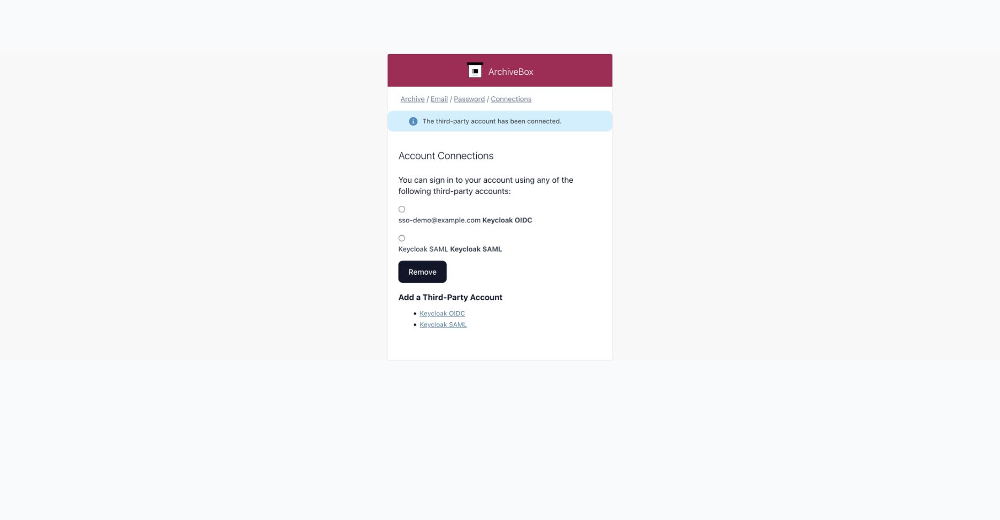

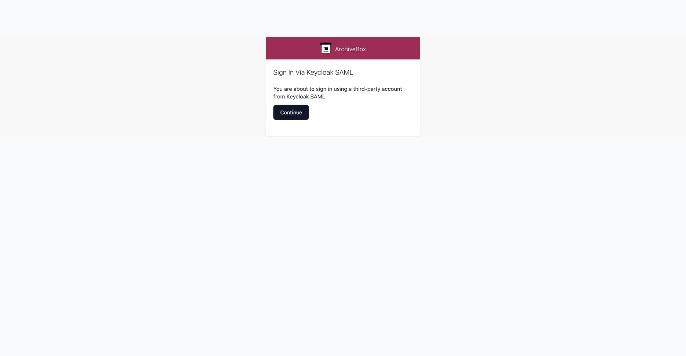


#### Server security modes and hostnames

| Mode | Authentication |
| --- | --- |
| `auto` | Uses the resolved mode: isolated subdomains on `.localhost`, otherwise safe single-domain replay. |
| `safe-subdomains-fullreplay` | Login and every provider callback live on `admin.*`; session, CSRF, and temporary SAML cookies stay host-only there. |
| `safe-onedomain-nojsreplay` | Login and callbacks use the configured server hostname; archived scripts remain disabled. |
| `danger-onedomain-fullreplay` | Login works on the configured hostname, with that mode's existing shared-origin risks. |
| `unsafe-onedomain-noadmin` | All login, account, callback, and admin routes remain forbidden. SSO does not bypass this mode. |

In isolated mode, `api.*` still requires API credentials. Browser SSO does not
make API requests authenticated. The only cookie shared with the public/replay
hostname family is `archivebox_admin_logged_in=1`, a UI hint that grants no
permission. Neither the admin session nor temporary provider state is shared
with `web.*`, `snap-*.*`, or original-domain replay hosts such as
`example.com.archivebox.example`. Login redirects may return to the explicitly
configured ArchiveBox hostname family, but not arbitrary external destinations.

Private replay retains its existing host-only, snapshot-scoped replay grants.
These are separate from the shared one-bit hint: they authorize reading the
granted private snapshot, never administration or API access. They contain no
admin, API, CSRF, or SSO credentials and are checked against the live server-side
login session; local logout or password changes revoke their authority. Replay
hosts may receive only the shared hint and their own scoped replay grant.

#### Registration, permissions, and linking

- `REGISTRATION_ENABLED=False` allows only existing linked SSO accounts to sign in.
  To link an existing administrator, first log in locally and open **Account → Connections**
  (`/accounts/3rdparty/`).
- `REGISTRATION_ENABLED=True` with `REGISTRATION_MODE=approval` creates inactive
  administrator accounts through SSO. An existing administrator must activate them
  in `/admin/auth/user/` before they can sign in.
- `REGISTRATION_MODE=open` activates new SSO administrator accounts immediately.
  Restrict access to the ArchiveBox application at your identity provider before enabling it.
- A matching email does not link accounts by default. Account linking requires
  an authenticated user's explicit action. To deliberately trust provider-verified
  email for login to existing accounts, enable `SOCIALACCOUNT_EMAIL_AUTHENTICATION`.
  Add `SOCIALACCOUNT_EMAIL_AUTO_CONNECT=True` only if you also want to persist
  that association. Unverified provider emails cannot authorize this matching.
  These options grant configured trusted providers authority over local accounts.

#### Password recovery

SSO users reset their passwords through their identity provider. For a local administrator,
run `archivebox manage changepassword USERNAME` inside the collection. With Docker Compose,
run `docker compose exec archivebox archivebox manage changepassword USERNAME`.

To enable email password resets, configure `EMAIL_HOST`, `EMAIL_PORT` (default 587),
`EMAIL_HOST_USER`, `EMAIL_HOST_PASSWORD`, and `DEFAULT_FROM_EMAIL` in `[ALLAUTH_CONFIG]`.
**Forgot your password?** opens the email reset form when `EMAIL_HOST` is configured.
Otherwise, it displays the administrator's SMTP setup and command-line recovery instructions.
TLS is enabled by default; for implicit TLS set `EMAIL_USE_SSL=True` and `EMAIL_USE_TLS=False`.
Set `EMAIL_VERIFICATION=mandatory` to require email confirmation for local logins.

Logout clears the local ArchiveBox session and requires POST. It does **not**
automatically terminate every IdP session. SAML's SLS callback is exposed, but
SP-initiated global logout and OIDC back-channel logout are not implemented here.
An existing IdP session may therefore sign the user back in without another
password prompt. `LOGOUT_REDIRECT_URL` can send users to a deployment-specific
logout landing page.


Established-administrator login uses allauth's standard admin protection, so the
old `/admin/login/` password endpoint cannot bypass allauth's email-verification
or login rate limits. First-administrator setup remains available. Local
username/password login uses the same allauth page as provider login.

ArchiveBox's default server has one HTTP worker and an in-process Django cache.
Rate-limit state resets when that process restarts. Custom deployments with
multiple web workers need a shared Django cache and correctly configured trusted
proxy/client-IP handling; see [allauth's rate-limit deployment requirements](https://docs.allauth.org/en/latest/common/rate_limits.html#deployment-requirements).
Do not assume separate processes share the default rate-limit counters.


#### Other OAuth social providers

Use an allauth provider name as a key in the same `SOCIALACCOUNT_PROVIDERS`
dictionary. Only configured provider modules are loaded. For example:

```json
{
  "github": {
    "APP": {
      "client_id": "YOUR_CLIENT_ID",
      "secret": "YOUR_CLIENT_SECRET"
    }
  }
}
```

GitHub's callback is `https://ADMIN_HOST/accounts/github/login/callback/`.
Google and other providers have their own settings, scopes, and callback URLs;
see the [allauth provider documentation](https://docs.allauth.org/en/latest/socialaccount/providers/index.html).
Merge provider entries into one dictionary to offer multiple login choices.
Provider login initiation requires CSRF-protected POST confirmation. Access and
refresh tokens are not stored in the ArchiveBox database.


#### Troubleshooting

| Symptom | Check |
| --- | --- |
| Provider is absent | Install the extra, enable allauth, configure its `SOCIALACCOUNT_PROVIDERS` entry, run migrations, and restart. |
| Redirect URI or SAML destination mismatch | Register the exact admin-host URL, scheme, port, provider slug, and trailing slash. Do not send the ACS POST through a redirect from a replay host. |
| OIDC third-party login failure | Check IdP/server logs, issuer reachability, copied client secret, callback, and PKCE. A masked password field is not the secret; use the provider's copy button. |
| SAML signature error | Enable IdP assertion signing, use current IdP metadata/certificate, and keep host clocks synchronized. |
| Account Inactive | An administrator must activate the new user when approval is enabled. |
| Existing email / account collision | Log in to the existing account and explicitly connect the provider in Account Connections. |
| Login immediately returns without a password | Local logout does not terminate the IdP session. This is expected SSO behavior. |

<br/>

---

<br/>

## REST API

The REST API (available starting in v0.8.0) supports several methods of authentication for convenience.  
  
To see API docs, try endpoints interactively, and see how auth works, visit this URL on your ArchiveBox server:  
[`http://api.archivebox.localhost:5797/api/v1/docs`](http://api.archivebox.localhost:5797/api/v1/docs)


<br/><br/>

To get started using the REST API, you can generate an API key for your user in the Admin Web UI:
[`http://admin.archivebox.localhost:5797/admin/api/apitoken/add/`](http://admin.archivebox.localhost:5797/admin/api/apitoken/add/)

or by calling the `http://api.archivebox.localhost:5797/api/v1/auth/get_api_token` endpoint with a username & password:
```bash
curl -X 'POST' \
  'http://api.archivebox.localhost:5797/api/v1/auth/get_api_token' \
  -H 'Content-Type: application/json' \
  -d '{"username": "YOURUSERNAMEHERE", "password": "YOURPASSWORDHERE"}'
```

<br/>

> [!TIP]
> Bearer Tokens are the recommended method for the best balance of security and convenience.


### API Bearer Token Authentication

Pass `Authorization=Bearer YOURAPITOKENHERE` as a request header.

```bash
curl -X 'GET' \
  'http://api.archivebox.localhost:5797/api/v1/core/snapshots?limit=10' \
  -H 'accept: application/json' \
  -H 'Authorization: Bearer YOURAPITOKENHERE'
```

### API Request Header Authentication

> This method is provided in case you have a reverse proxy in front of ArchiveBox that consumes the bearer header.

Pass `X-ArchiveBox-API-Key=YOURAPITOKENHERE` as a request header.

```bash
curl -X 'GET' \
  'http://api.archivebox.localhost:5797/api/v1/core/snapshots?limit=10' \
  -H 'accept: application/json' \
  -H 'X-ArchiveBox-API-Key: YOURAPITOKENHERE'
```

<br/>

### API Query Parameter Authentication

> [!WARNING]
> This method is sometimes known as ["Capability URLs"](https://w3ctag.github.io/capability-urls/) because anyone in possession of the URL can perform API actions. It comes with [important security caveats](https://security.stackexchange.com/questions/118975/is-it-safe-to-include-an-api-key-in-a-requests-url) and is not recommended unless you fully understand the risks.

Pass `api_key=YOURAPITOKENHERE` as a GET/POST query parameter.

```bash
curl -X 'GET' \
  'http://api.archivebox.localhost:5797/api/v1/core/snapshots?limit=10&api_key=YOURAPITOKENHERE' \
  -H 'accept: application/json'
```

<br/>

#### Further Reading

- The ArchiveBox API auth implementation: [`archivebox/api/auth.py`](https://github.com/ArchiveBox/ArchiveBox/blob/dev/archivebox/api/auth.py#:~:text=API_AUTH_METHODS) + [`archivebox/api/v1_auth.py`](https://github.com/ArchiveBox/ArchiveBox/blob/dev/archivebox/api/v1_auth.py)
- The [`django-ninja` auth documentation](https://django-ninja.dev/guides/authentication/) (which powers our API)
- The [Swagger auth documentation](https://swagger.io/docs/specification/authentication/) for the interactive API Docs UI
