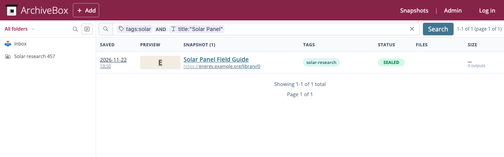

# Setting Up Search

## How to Search in ArchiveBox

The public index, Snapshot admin, mobile search, REST search, and `archivebox list` and `archivebox search` accept the same expression. For example, enter `tags:solar (title:"Solar Panel" OR site:solarcity.com) ~status:queued`. On the command line, wrap the complete expression in single quotes to preserve its double quotes and parentheses.



| Syntax | Matches |
| --- | --- |
| `panel`, `"solar panel"` | A search term, or a literal contiguous substring. Quotes preserve punctuation, including colons. |
| `AND`, `OR`, `~`, `( … )` | Negation binds first, then AND, then OR. A space between operands also means AND. |
| `domain:example.com`, `site:*.example.com` | An HTTP(S) host. A wildcard includes its subdomains and the host itself. |
| `tags:solar,research`, `plugins:pdf,reader` | Every listed substring must match a tag or a successful plugin name, respectively. Quote an item containing spaces or commas. |
| `owner:alice`, `title:"field guide"`, `status:sealed`, `permissions:public` | The corresponding snapshot metadata contains the supplied value. |
| `after:2026`, `before:2028`, `bookmarked:2026-12-31` | Bookmark time in UTC. After is inclusive, before is exclusive, and bookmarked matches a whole year, month, or day. |
| `filetype:pdf,png` | A saved output filename ends in any listed extension. |
| `meta:"solar panel"` | A substring in database metadata. Public searches use public metadata. |
| `linksto:example.com`, `linkedfrom:example.com` | Match a literal substring anywhere in the outgoing or source HTTP(S) URL. For example, `linkedfrom:ycombinator.com` includes links from `news.ycombinator.com`. |
| `output_size__gte:"1 MB"` | A Smart Folder field and comparison using the builder's types and relationship IDs. Administrative searches support the full builder schema. |

In `linkedfrom:"https://example.com/page"`, the colon in `https:` is literal text inside the quoted value. Text operators match the entire substring, so this also finds links from `https://example.com/page/other`. Text operands containing an uppercase letter match case. Lowercase operands ignore case where supported. Each operand makes this decision independently. Hostnames use DNS casing rules. The field suggests values as you type. Arrow keys move into badges for editing, Escape closes suggestions, and Enter runs the query.

Searching a folder, tag or domain further narrows the current view. Snapshot admin filters apply as well. Value suggestions come from the same selection. Clearing the query restores the filtered list.

### Results, ranking and limits

Search streams confirmed matches. For text searches, a literal substring in the domain ranks first, followed by the URL, title, other matching metadata and finally indexed content. Content results use provider order or available scores. An explicit column sort takes precedence. Existing `deep:` queries use ordinary text search.

Sonic is enabled by default. An empty index, a timeout or a connection failure does not enable filesystem scanning. To use the Ripgrep fallback, disable Sonic and any other content index and enable the Ripgrep plugin. For example, set `SEARCH_BACKEND_SONIC_ENABLED=False`, `SEARCH_BACKEND_SQLITE_ENABLED=False` and `SEARCH_BACKEND_RIPGREP_ENABLED=True`. An enabled SQLite index also takes precedence over Ripgrep. The fallback verifies only unresolved candidates in the current scope, with a shared two-second scan budget, up to 96 files, 512 directory entries and 4 MiB total (512 KiB per file). These limits apply to connected searches too.

A missing index entry, unreadable file or exhausted budget can leave membership unknown, including under negation. Editing the query or leaving the page cancels the stream. REST search and metadata export responses carry `X-ArchiveBox-Search-Partial: 1` when coverage is incomplete. The CLI reports partial coverage on stderr.

Smart Folders accept database-backed search expressions and the Advanced rule builder. Their saved sort and limit apply to the combined membership. Persistent membership must be decidable from database rows because moves and webhooks use it during writes. Full-text, file and link searches are available in the ordinary search field. Copied export URLs replay the expression and filters against current, authorized rows.

## ArchiveBox Search Backends

ArchiveBox provides a number of "Search Backend Engines" to tune its performance & behavior for different use-cases.
```bash
# this setting controls which search backend ArchiveBox uses
archivebox config --set SEARCH_BACKEND_ENGINE=sonic

# to see information about the backend you are currently using, run:
archivebox version
archivebox config --get SEARCH_BACKEND_ENGINE
```

Search uses Sonic by default. SQLite FTS is also available. Both use the collection's full-text index. Ordinary text queries also match recorded output filenames in the database. Existing `deep:` queries use the same text search.

<a name="sonic"></a>

### `sonic` ⭐️ (the recommended upgrade path for most people)

[Sonic](https://github.com/valeriansaliou/sonic) is a fast, lightweight, rust-based alternative to super-heavy traditional search backends like Elasticsearch. It is capable of normalizing natural language search queries, fuzzy matching, and searching Unicode, without needing to maintain a duplicate document store index of all the searchable text.

Internally it functions as an index store, storing only the original IDs of the Snapshots with a super-compressed representation of the text. This allows it to scale to searching terabytes of archive data while maintaining an index only a fraction of that size.

*ArchiveBox has supported Sonic for years, and it is the most thoroughly tested and recommended backend for ArchiveBox large collections.*

ArchiveBox resolves and starts Sonic through the same `abxpkg` lifecycle on both Docker and bare-metal installations.

```bash
archivebox config --set SEARCH_BACKEND_ENGINE=sonic
archivebox install sonic
archivebox update --index-only
archivebox search 'some text to search'
```

Run the same commands as `docker compose run --rm archivebox ...` when using Docker Compose.

*Fore more detailed instructions [see here](https://github.com/ArchiveBox/ArchiveBox/issues/956#issuecomment-1320587158)...*

#### Pros

- extremely fast, most queries complete in microseconds even with 100k+ snapshots
- maintains lightweight, compressed search index that is minuscule compared to original data
- all-in-one binary written in rust, available cross-platform and easy to deploy
- supports advanced full-text search features like normalization, stemming, etc.
- supports indexing and querying on a remote server (many ArchiveBox instances can share a single `sonic` instance)

#### Cons

- one extra dependency to install and background worker to keep running (Docker Compose makes this easy though)
- does not support searching binary files like PDFs, eBooks, compressed archives, etc.

<br/>

<a name="fts5"></a>

### `SQLite FTS5`

This is a [recently added](https://github.com/ArchiveBox/ArchiveBox/pull/1241) experimental option that uses a separate SQLite3 Database (similar to the one ArchiveBox already uses for Snapshot metadata) to provide full-text search.

```bash
archivebox config --set SEARCH_BACKEND_ENGINE=sqlite

# add existing data to index by running update:
archivebox update --index-only

# test it out using the archivebox Web UI or CLI:
archivebox search 'some text to search'
```

You can also inspect the separate FTS database directly:

```bash
sqlite3 ./search.sqlite3

> SELECT snapshot_id, url FROM search_index
      WHERE search_index MATCH 'some text to search';
```

```bash
# optional advanced tuning:
archivebox config --set FTS_SEPARATE_DATABASE=True
archivebox config --set FTS_TOKENIZERS="porter unicode61 remove_diacritics 2"
```

- https://www.sqlite.org/fts5.html
- https://github.com/ArchiveBox/ArchiveBox/pull/1241

#### Pros

- No additional dependencies needed to install, SQLite3 is already available and used by ArchiveBox
- No long-running background search worker process needed, 0 idle resource use
- Supports advanced full-text search features like boolean operators, stemming, phrases, etc.
- Comparable speed and efficiency to `sonic` for most use-cases (much faster than `ripgrep`/`ugrep`)
- Durability and portability, SQLite is widely used and supported by every major platform on earth

#### Cons

- Not as thoroughly-tested by ArchiveBox team as our `sonic` backend
- Maintains a (compressed, but still potentially large) duplicate copy of all searchable text in `search.sqlite3` db
- Does not support searching binary files PDFs, eBooks, compressed archives, etc.
- Search indexing and querying must be performed on same server as ArchiveBox data (we don't yet support sending FTS5 queries to a remote server)

<br/>

---

<br/>

### Further Reading

- https://github.com/ArchiveBox/ArchiveBox/blob/dev/docker-compose.yml#:~:text=SEARCH_BACKEND_ENGINE
- https://plugins.archivebox.io/#search_backend_sonic
- https://plugins.archivebox.io/#search_backend_sqlite

* [#22 Original Issue where full-text search functionality was proposed](https://github.com/ArchiveBox/ArchiveBox/issues/22)
* [#543 + #570 Original PR where full-text search functionality was implemented](https://github.com/ArchiveBox/ArchiveBox/pull/543)
* [#956 Documentation: Document how search works](https://github.com/ArchiveBox/ArchiveBox/issues/956#issuecomment-1320587158)
* [#654 Support: Search Backend only searching admin Snapshot fields instead of archive content](https://github.com/ArchiveBox/ArchiveBox/issues/654)
* [#1087 Support: Help setting up full text search](https://github.com/ArchiveBox/ArchiveBox/issues/1087) 
* [#1091 Support: Help switching to ripgrep-all](https://github.com/ArchiveBox/ArchiveBox/issues/1091)
* [#1318 Troubleshooting: Search times out on v0.7.2 installed on Synology using Portainer](https://github.com/ArchiveBox/ArchiveBox/issues/1318)
* [#1333 + #1316 Text Search and Filters don't work at the same time in the web UI](https://github.com/ArchiveBox/ArchiveBox/pull/1333)
* [#1320 Troubleshooting: Sonic backend Error: ENDED authentication_failed doesn't contain protocol(NUMBER)](https://github.com/ArchiveBox/ArchiveBox/pull/1320)

- [#1139 Feature Request: Add AI-assisted summarization, tagging, search, and more using LLMs / RAG](https://github.com/ArchiveBox/ArchiveBox/issues/1139)
- [#1358 Django Admin general improvements: tree view, better filters, better sorting, custom pages, etc.](https://github.com/ArchiveBox/ArchiveBox/issues/1358)
